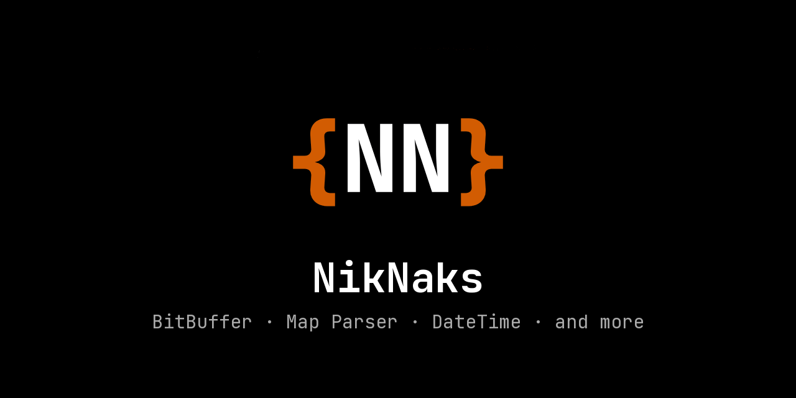

 A pure Lua library with various features for Garry's Mod I've created.
 It features an adv BitBuffer, BSP Parser, BSP Objects , PVS/PAS, and more.
 
>***Note:** May not be reuploaded to workshop without specific prior written permission. 
See: https://github.com/Nak2/NikNaks/blob/main/LICENSE for more info.
In case you need NikNaks for your addon, add the [offical addon](https://steamcommunity.com/sharedfiles/filedetails/?id=2861839844) to the required Items on your workshop page.

### Quick Start

* [Getting started](https://github.com/Nak2/NikNaks/wiki/Getting-started)
* [Wiki page](https://github.com/Nak2/NikNaks/wiki)
* FAQ (Comming soon)

### Documentation

* [BitBuffer](https://github.com/Nak2/NikNaks/wiki/BitBuffer)
* [BSP Parser](https://github.com/Nak2/NikNaks/wiki/BSP-Parser)
* [PVS / PAS](https://github.com/Nak2/NikNaks/wiki/PVS-and-PAS)
* [DateTime and Date-Functions](https://github.com/Nak2/NikNaks/wiki/DateTime-and-Date-Functions)
* [TimeDelta](https://github.com/Nak2/NikNaks/wiki/TimeDelta)
* [NodeGraph]
* [Misc functions]()

### 0.99 changes (unreleased)

Additive BSP query and mesh APIs accompany the lighting and entity-data corrections below.

* `NikNaks.EntityValue( entity, name )` reads the first value of a key without regard to case, leaving raw BSP records unchanged.
* `NikNaks.ParseEntityOutput( value )` parses Hammer output actions, preserving commas inside ESC-delimited parameters. Missing inputs default to `Use`; a zero fire count means unlimited.
* `BModel:GetBrushes()` returns the cached unique brushes beneath its BSP head node.
* `BSP:GetFaceClusters( pause )` returns raw leaf-face visibility membership. Consumers must account for brush-model transforms; the cached table belongs to the BSP.
* `NikNaks.MeshBuilder( true )` optionally accumulates triangle bounds while collecting vertices. `builder:GetBounds()` and the built mesh's `GetBounds()` return those bounds. Shader deformation is not included; ordinary builders retain their previous behavior.
* `BSP:SurfaceTraceBlocked()` is an early-out boolean surface query with the same masks, winding, displacement and endpoint rules as `SurfaceTraceLine()`. Use the full trace when the nearest hit or sky flag matters.

Mesh building and lightmap atlases preserve directional bump-light coordinates, tangents and valid black lighting. Optional material callbacks bind scaled material variants without mutating the source material. Atlas writes can explicitly convert to linear color for native LDR rendering into float targets.

`CalculateAmbientCube()` now returns linear RGBExp32 irradiance, without dividing the byte mantissa by 255. This corrects model lighting and changes the numeric values returned by that public API. Consumers which compensated for the previous normalization must remove that compensation when upgrading. Display-oriented `CalculateAmbientColor()` retains its existing contract.
